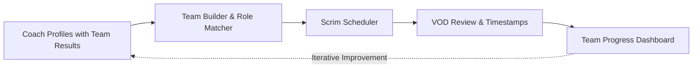
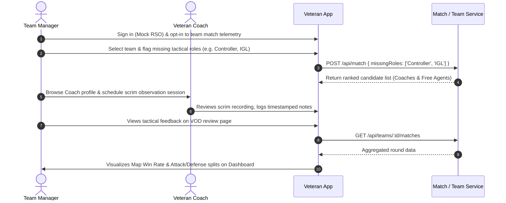
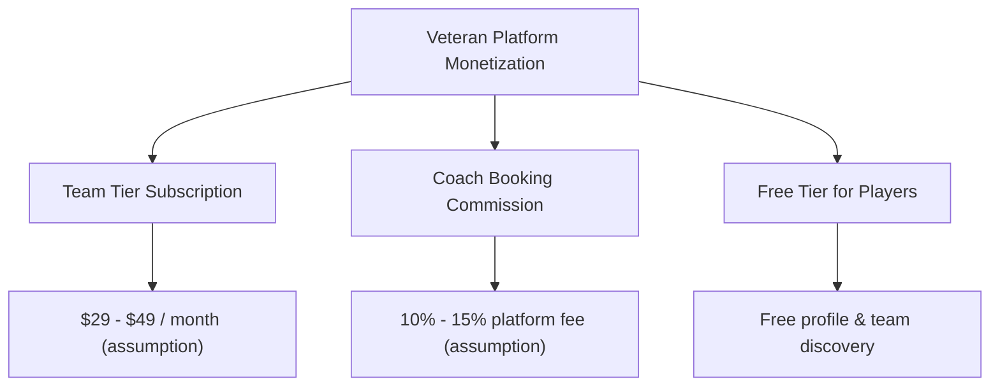

# Veteran: Tactical VALORANT Coaching & Team-Building Platform
**Hackathon Project Report | Category: eSports**

---

## 1. Problem Statement
First-person tactical shooters like Riot Games’ *VALORANT* require microsecond reaction times, sharp mechanical micro-aim, and split-second flicking. Research on StarCraft 2 players found that reaction speed begins to decline in the mid-20s (Thompson et al., 2014). We use this as a proxy for tactical shooters like VALORANT; it is not a VALORANT-specific finding. As a consequence, thousands of experienced Tier-2, Tier-3, and collegiate competitors face an abrupt "career cliff" where they can no longer out-aim 17-year-old prodigies. 

However, these veteran players possess deep tactical capital:
* Sophisticated understanding of map macro and economy rotations.
* Mid-round shot-calling and anti-strat discipline.
* Smoke timing, utility combo synchronization, and site retake protocols.

Simultaneously, the rapidly expanding amateur ecosystem—spanning collegiate leagues (e.g., NACE, Red Bull Campus Clutch) and semi-pro circuits (VALORANT Challengers, Premier Contender)—struggles with two chronic bottlenecks:
1. **Lack of tactical leadership:** Young rosters rely excessively on raw mechanical aim, falling apart during coordinated retakes and defensive holds.
2. **High roster churn:** Teams consistently cycle through missing roles (such as dedicated Controllers or in-game leaders) without structured matching or coaching oversight.

Currently, no dedicated platform channels the strategic knowledge of aging tactical competitors directly into organized amateur team growth.

---

## 2. Target Users

### Primary Users: Ex-Competitors & Veteran Mentors (Mid-20s)
* Former semi-pro, collegiate captains, and high-Immortal/Radiant players whose mechanical aim is no longer competitive at the highest tier.
* Seeking flexible, paid esports roles to monetize 5+ years of tactical knowledge without needing to maintain an 8-hour daily aim-training regimen.

### Secondary Users: Collegiate and Semi-Pro Team Captains / Managers
* Collegiate teams competing in structured circuits that lack a full-time university-funded coaching staff.
* Semi-pro / Premier teams seeking to solve specific roster holes (e.g., missing a smoke anchor or shot-caller) and convert disorganized play into structured tournament runs.

### Tertiary Users: Developing Free Agents
* Ranked players can be discovered by teams through opt-in profiles built on team roles, not solo-queue rank.

---

## 3. Existing Platforms and Gaps

| Platform | Core Capabilities | Gaps for Our Concept | Source URL |
| :--- | :--- | :--- | :--- |
| **WeCoach** | Connects individual players to verified pros for 1-on-1 gameplay lessons and VOD reviews across multiple titles. | Focuses on individual consumer rank-up lessons ("play with a pro"); lacks roster management, role-based team builder, and scrim analytics. | [wecoach.gg](https://wecoach.gg) |
| **ReadyUp** | Started as an amateur team management and scheduling hub (2017); subsequently pivoted towards fan-discovery SaaS and creator event scheduling. | Does not offer specialized tactical role matching for VALORANT, nor does it provide integrated timestamped VOD feedback or round analytics. *(Status of legacy team management tool: unverified/inactive).* | [gamesindustry.biz](https://www.gamesindustry.biz/readyup-esports-management-platform-raises-usd2m) |
| **Gamer Sensei** | Pioneer coaching marketplace offering skills benchmark assessments and curriculum-based training; acquired by Corsair in 2020. | Acquired and largely sunsetted as an independent marketplace *(unverified active storefront; directs to Corsair ecosystem)*. Focused primarily on individual hourly lessons rather than roster construction or team scrim telemetry. | [corsair.com](https://www.corsair.com/us/en/explorer/gamer-sensei/) |

**The Gap:** Existing platforms treat esports coaching as an individual consumer transaction (a solo-queue player paying $20 to get out of Silver). None of them bridge team-level tactical mechanics, role-overlap team building, and persistent team progression analytics in a unified platform.

---

## 4. Our Solution: The "Veteran" Platform
*Veteran* is a full-stack tactical operations hub built around 5 integrated pillars:



1. **Coach Profiles with Team Results:** Coaches are showcased not by solo KDA, but by team-level outcomes. Example (fictional): Team Alpha improved from 42% to 65% win rate. All coach results in the demo are seeded placeholder data.
2. **Team Builder (Role-Based Matcher):** Teams declare missing compositions (e.g., *Controller*, *IGL*). An algorithmic scoring engine ranks free agents and veteran coaches based on utility overlap and agent mastery.
3. **Integrated VOD Review Tool:** Coaches paste YouTube/Twitch scrim links and insert timestamped tactical notes that jump directly to key execution breakdowns.
4. **Scrim Scheduler:** Direct booking interface with date selection, and map veto assignments.
5. **Team Progress Dashboard:** Interactive analytics powered by Recharts tracking win rates by map, attack vs. defense half splits, and recent match histories.

---

## 5. How It Works (Step-by-Step User Flow)



1. **Identity & Opt-In:** Team manager authenticates via the simulated Riot Sign On (RSO) flow, explicitly consenting to display team match telemetry.
2. **Roster Diagnosis:** The manager selects their squad and ticks missing tactical requirements (e.g., Controller, IGL, Anti-strat).
3. **Algorithmic Candidate Ranking:** The backend parses candidate agent pools and tactical roles, returning ranked scores.
4. **Coach Engagement:** The manager views the coach’s track record, hourly rate, and books a tactical review session.
5. **Execution & Feedback:** Following a scrim, the coach imports the replay link, annotates critical round failures (e.g., *"04:12 - Omen smoke dropped 3 seconds early"*), and shares the feedback report with the roster.
6. **Telemetry & Iteration:** Team progress is tracked on the dashboard across maps, revealing whether defensive retakes or offensive executions improved.

---

## 6. Tech Stack and Architecture

```
[ Frontend: React 18 + Vite ] <---> [ Tailwind CSS + Recharts + Lucide ]
             |
       (REST API /api)
             |
[ Backend: Node.js + Express (ES Modules) ]
             |
[ Services Layer: matchService.js (Riot API abstraction) ]
             |
[ Local JSON Storage: /backend/data/*.json (via jsonStorage.js) ]
```

* **Frontend:** React 18, Vite, Tailwind CSS, React Router v6, Recharts (for data visualization), Lucide-react (icons).
* **Backend:** Node.js, Express 4 (pure ES modules), CORS middleware.
* **Storage Engine:** Local structured JSON storage (`/backend/data/`) managed via atomic read/write helpers (`jsonStorage.js`), removing heavy external database dependencies for self-contained hackathon evaluation.
* **Build & Dev Tooling:** Single root orchestration script (`concurrently`) enabling unified execution via `npm install && npm run dev`.

---

## 7. VALORANT API Plan

### Live Riot API Requirements
* Integration with live Riot Games services requires an approved **Production API Key** and **Riot Sign On (RSO)** client registration with Riot Developer Relations.
* Live match data would be retrieved via `VAL-MATCH-V1` endpoints (`/val/match/v1/matches/{matchId}`).
* *MatchService Abstraction:* All match data access is encapsulated in `backend/services/matchService.js` with documented injection points ready to swap local JSON reads for authenticated `https://{region}.api.riotgames.com/` requests.

### Riot Developer Policy Compliance
* **No Opponent Scouting:** In compliance with Riot’s API policies prohibiting unauthorized competitive scouting or exposing non-public enemy tendencies, *Veteran* does **not** feature any opponent scouting tools.
* **Opt-In Privacy Guardrails:** Players and teams only see their own opted-in scrim and tournament logs. No opponent statistics or non-consenting player profiles are indexed.
* **Explicit Labeling:** All endpoints and UI components are explicitly labeled with:
  > *"PLACEHOLDER DATA - not from Riot API. Real Riot Sign On requires production API approval."*
* **No API Keys in Code:** No API keys or credentials are used in the code. [CONFIRM AFTER SEARCHING THE REPO]

---

## 8. What is Built vs. Mocked

| Feature Area | Component | Implementation Status | Notes |
| :--- | :--- | :--- | :--- |
| **Authentication** | Sign in with Riot | **Mocked** | Simulated RSO with mandatory privacy opt-in checkbox and pre-seeded accounts. |
| **Coach Directory** | Specialty & Agent Filtering | **[CONFIRM: Working / Partial / Mocked]** | Live backend query filtering coaches by specialty (IGL, controller, anti-strat) and agent pool. |
| **Coach Profiles** | Bio, Rates & Progression | **[CONFIRM: Working / Partial / Mocked]** | Displays before/after team win-rate case studies and working booking modal. |
| **Team Builder** | Role-Overlap Matching | **[CONFIRM: Working / Partial / Mocked]** | Algorithmic scoring engine (`POST /api/match`) matching players and coaches against missing roles. |
| **VOD Review** | Timestamped Video Tool | **[CONFIRM: Working / Partial / Mocked]** | Embedded responsive video player with real-time note creation and timestamp filtering. |
| **Scrim Hub** | Scrim Scheduler & Log | **[CONFIRM: Working / Partial / Mocked]** | Form to schedule scrims, choose map vetoes, and track status (`scheduled`, `completed`, `cancelled`). |
| **Analytics** | Team Dashboard | **[CONFIRM: Working / Partial / Mocked]** | Real-time calculations of map win rates, attack vs. defense splits, and last-5 match recaps using Recharts. |
| **Match Engine** | Match Ingestion | **Mocked / Seeded** | 8 complete matches structured in `VAL-MATCH-V1` schema read via `matchService.js`. |

---

## 9. Revenue Model

> [!NOTE]
> All financial figures, subscription pricing, and market projections listed below are **assumptions** developed for project planning and have not been validated in live commerce.



1. **Team Subscription (SaaS):**
   * *$29/month (assumption)* for collegiate clubs; *$49/month (assumption)* for semi-pro organizations.
   * Unlocks VOD storage and roster management.
2. **Coach Booking Commission (Marketplace Fee):**
   * *12% commission (assumption)* deducted from hourly coaching sessions booked and paid through the platform.
3. **Free Tier for Players & Free Agents:**
   * Free agent listings and role search remain 100% free to maintain high liquidity on the supply side of talent.

---

## 10. Risks and Limitations

1. **Riot Production API Approval Gate:** Riot Games maintains rigorous evaluation standards for production API keys. Without approval, the platform cannot ingest official competitive match IDs and must rely on custom scrim lobbies or manual match exports.
2. **Riot Policy on Paid Analytics:** Riot requires that content charged to players be transformative. Our paid tier covers team tools (VOD storage, scheduling, roster management). Match-based analytics would be confirmed with Riot before being charged for.
3. **Platform Leakage to Discord:** Once a team establishes rapport with a coach, they may attempt to take future payments and sessions off-platform to Discord to avoid platform fees. 
   * *Mitigation:* The platform must provide sticky software value (VOD timestamp history, shared team playbooks, automated round analytics) that cannot be replicated in a Discord call.
4. **Cold-Start Liquidity Problem:** A two-sided marketplace requires both coaches and teams to be active simultaneously.
   * *Mitigation:* Seed the platform initially by partnering directly with 4–6 collegiate esports directors and veteran Tier-2 players (*unverified operational pilot*).
5. **Limited Supply of Ex-Pros:** The total pool of retired semi-pro players in their mid-20s is finite compared to the broader player base.
6. **Low Barrier to Feature Duplication:** Established stats platforms (e.g., Tracker Network) could theoretically add team scheduling modules. Our moat rests in verified coach track records and role-overlap algorithms.

---

## 11. Future Scope

* **Coach and result verification (e.g., via Riot match data after API approval).**
* **Automatic VOD Timestamping via Computer Vision / OCR:** Detect killfeed events, spike plants, and round losses directly from video frames to automatically generate review timestamps.
* **Custom Tactical Playbook Builder:** Interactive 2D map board where coaches can diagram smokes, flashes, and default protocols for team reference.
* **Discord Bot Integration:** Automated webhook notifications pushed to team Discord servers for upcoming scrims and newly assigned coach VOD reviews.
* **Collegiate League Management Portal:** White-label dashboard for university esports directors to monitor multiple collegiate rosters across academic terms.

---

## 12. Conclusion
The narrative that esports competitors become obsolete at age 24 is an inefficient byproduct of an industry that historically valued aim over structured teamwork. *Veteran* reimagines this dynamic by providing ex-competitors with a dignified, monetizable pathway into tactical mentorship, while providing collegiate and semi-pro VALORANT teams with the missing roles and strategic coaching they need to succeed.

---

## 13. Sources & References

1. **Thompson, J. J., Blair, M. R., & Henrey, A. J. (2014).** [VERIFY ON PLOS ONE]. [https://doi.org/[VERIFY ON PLOS ONE]](https://doi.org/[VERIFY ON PLOS ONE])
2. **Riot Games, VALORANT Developer API Policy.** [https://developer.riotgames.com/docs/valorant](https://developer.riotgames.com/docs/valorant)
3. **WeCoach Platform:** *Esports Coaching and VOD Reviews.* [https://wecoach.gg](https://wecoach.gg)
4. **ReadyUp Esports:** *ReadyUp esports management platform raises $2M.* GamesIndustry.biz. [https://www.gamesindustry.biz/readyup-esports-management-platform-raises-usd2m](https://www.gamesindustry.biz/readyup-esports-management-platform-raises-usd2m)
5. **Gamer Sensei / Corsair:** *CORSAIR Acquires Esports Coaching Platform Gamer Sensei.* [https://www.corsair.com/us/en/explorer/gamer-sensei/](https://www.corsair.com/us/en/explorer/gamer-sensei/)
